# 🏗️ Software Architecture Series

[Part 1: Procedural Baseline](https://github.com/Sharaf-Ahmed-Dev/arch-1-procedural) | [Part 2: OOP Migration](https://github.com/Sharaf-Ahmed-Dev/arch-2-oop) | [Part 3: SOLID Principles](https://github.com/Sharaf-Ahmed-Dev/arch-3-solid) | **Part 4: Design Patterns (Current Repo)**

---

## Software Architecture Series - Part 4: Design Patterns Implementation

## 📌 Overview

This repository contains **Part 4**, the final installment of a 4-part software architecture refactoring series. Building upon the SOLID foundation established in Part 3, this milestone integrates enterprise **Design Patterns** (Creational, Structural, and Behavioral) alongside Java 8+ functional Stream APIs.
 updates, dynamic discount stra
The system now features dynamic object instantiation, thread-safe global catalog management, event-driven observertegies, and stream processing for real-time inventory metrics and revenue aggregation.

> [!NOTE]
> **Educational Intent:** This final phase demonstrates how Gang of Four (GoF) design patterns resolve real-world architectural challenges such as decoupling instance creation, ensuring single-instance integrity, managing dynamic pricing logic, and broadcasting state changes without tight coupling.

---

## 🏛️ Design Patterns & Architectural Enhancements

| Pattern / Technique | Type | Purpose & Java Implementation |
| --- | --- | --- |
| **Singleton Pattern** | Creational | Guarantees a single, globally accessible instance of `BookstoreManager` across the application lifecycle using thread-safe double-checked locking. |
| **Factory Method Pattern** | Creational | Encapsulates domain model creation inside `BookFactory`, dynamically instantiating `PrintedBook` or `EBook` instances based on specified format parameters. |
| **Strategy Pattern** | Behavioral | Encapsulates interchangeable pricing policies via `DiscountStrategy` (`NoDiscount`, `MemberDiscount`, `SeasonalDiscount`), allowing runtime selection without modifying payment logic. |
| **Observer Pattern** | Behavioral | Implements a decoupled pub/sub event system via `Subject` and `Observer` interfaces. `CustomerNotificationListener` and `InventoryLogger` automatically react to catalog updates and transaction completions. |
| **Batch Inventory Loader** | Structural / Service | Decouples catalog initialization from core management, populating stock dynamically via bulk batch imports. |
| **Java Stream API Metrics** | Functional Processing | Enables declarative catalog querying, dynamic valuation calculations, sub-price filtering, and revenue aggregate tracking. |

---

## 📐 UML Class Diagram

```mermaid
classDiagram
    class Book {
        <<abstract>>
        -String title
        -String author
        -double price
        +Book(title : String, author : String, price : double)
        +getTitle() String
        +setTitle(title : String) void
        +getAuthor() String
        +setAuthor(author : String) void
        +getPrice() double
        +setPrice(price : double) void
        +getFormatDetails()* String
        +displayBook(index : int) void
    }

    class PrintedBook {
        -double weightInKg
        +PrintedBook(title : String, author : String, price : double, weightInKg : double)
        +getWeightInKg() double
        +getFormatDetails() String
    }

    class EBook {
        -double fileSizeMb
        +EBook(title : String, author : String, price : double, fileSizeMb : double)
        +getFileSizeMb() double
        +getFormatDetails() String
    }

    class BookFactory {
        +createPrintedBook(title : String, author : String, price : double, weightInKg : double) Book
        +createEBook(title : String, author : String, price : double, fileSizeMb : double) Book
    }

    class BookstoreManager {
        -BookstoreManager instance$
        -List~Book~ inventory
        -List~Observer~ observers
        -double totalRevenue
        -BookstoreManager()
        +getInstance() BookstoreManager$
        +addBook(book : Book) void
        +registerObserver(observer : Observer) void
        +notifyObservers(event : String, message : String) void
        +calculateTotalInventoryValue() double
        +getBooksCheaperThan(threshold : double) List~Book~
        +recordRevenue(amount : double) void
        +getTotalRevenue() double
    }

    class Observer {
        <<interface>>
        +update(event : String, message : String) void
    }

    class CustomerNotificationListener {
        +update(event : String, message : String) void
    }

    class InventoryLogger {
        +update(event : String, message : String) void
    }

    class Calculable {
        <<interface>>
        +calculateTotal(books : List~Book~, discountStrategy : DiscountStrategy) double
    }

    class BillCalculator {
        +calculateTotal(books : List~Book~, discountStrategy : DiscountStrategy) double
    }

    class DiscountStrategy {
        <<interface>>
        +applyDiscount(rawTotal : double) double
        +getStrategyName() String
    }

    class NoDiscount {
        +applyDiscount(rawTotal : double) double
        +getStrategyName() String
    }

    class MemberDiscount {
        +applyDiscount(rawTotal : double) double
        +getStrategyName() String
    }

    class SeasonalDiscount {
        +applyDiscount(rawTotal : double) double
        +getStrategyName() String
    }

    class Printable {
        <<interface>>
        +printInvoice(invoice : Invoice) void
    }

    class ConsoleInvoicePrinter {
        +printInvoice(invoice : Invoice) void
    }

    class Purchase {
        -int purchaseId
        -Customer customer
        -List~Book~ purchasedBooks
        +Purchase(purchaseId : int, customer : Customer)
        +addBook(book : Book) void
        +checkout(calculator : Calculable, discountStrategy : DiscountStrategy) Invoice
    }

    class Invoice {
        -int invoiceId
        -Customer customer
        -List~Book~ books
        -double totalAmount
        -DiscountStrategy discountStrategy
    }

    %% Relationships
    Book <|-- PrintedBook
    Book <|-- EBook
    BookFactory ..> Book : creates

    Observer <|.. CustomerNotificationListener
    Observer <|.. InventoryLogger

    DiscountStrategy <|.. NoDiscount
    DiscountStrategy <|.. MemberDiscount
    DiscountStrategy <|.. SeasonalDiscount

    Calculable <|.. BillCalculator
    Printable <|.. ConsoleInvoicePrinter

    BookstoreManager "1" o-- "0..*" Observer : observers
    BookstoreManager "1" o-- "0..*" Book : inventory
    Purchase "1" o-- "0..*" Book : purchasedBooks
    Invoice "1" -- "1" DiscountStrategy : discountStrategy

```



---

## 🛠️ Code Structure & Module Breakdown

```text
arch-4-patterns/
├── src/
│   ├── BatchInventoryLoader.java        # Service: Bulk catalog populator
│   ├── BillCalculator.java              # Engine: Calculation service implementing Calculable
│   ├── Book.java                        # Domain: Abstract base entity for catalog items
│   ├── BookFactory.java                 # Factory Pattern: Instantiates PrintedBook and EBook
│   ├── BookstoreManager.java            # Singleton & Subject: Thread-safe inventory state
│   ├── Calculable.java                  # Interface: Bill calculation contract
│   ├── ConsoleInvoicePrinter.java       # Presenter: CLI implementation of Printable
│   ├── Customer.java                    # Domain: User profile encapsulation
│   ├── CustomerNotificationListener.java# Observer: Handles customer event notifications
│   ├── DiscountStrategy.java            # Strategy Interface: Dynamic discount contracts
│   ├── EBook.java                       # Domain: Digital book model (file size)
│   ├── InventoryLogger.java             # Observer: Logs administrative inventory transactions
│   ├── Invoice.java                     # Domain: Immutable transaction receipt model
│   ├── Main.java                        # Driver: System orchestration & CLI interface
│   ├── MemberDiscount.java              # Strategy: 10% member discount implementation
│   ├── NoDiscount.java                  # Strategy: Standard purchase (0% discount)
│   ├── Observer.java                    # Observer Interface: Event listener contract
│   ├── Printable.java                   # Interface: Invoice rendering contract
│   ├── PrintedBook.java                 # Domain: Physical book model (weight)
│   ├── Purchase.java                    # Context: Shopping cart aggregate & checkout controller
│   └── SeasonalDiscount.java            # Strategy: 15% festival discount implementation
└── README.md

```

---

## ⚖️ Architectural Evolution Matrix (Parts 1 – 4)

| Metric / Dimension | Part 1: Procedural Baseline | Part 2: OOP Migration | Part 3: SOLID Principles | Part 4: Design Patterns |
| --- | --- | --- | --- | --- |
| **Catalog State** | Parallel static arrays | Encapsulated `List<Book>` | Polymorphic `Book` hierarchy | **Thread-Safe Singleton** instance |
| **Object Creation** | Manual static assignment | Direct constructor calls (`new`) | Constructor instantiation | **Factory Method (`BookFactory`)** |
| **Pricing & Discounts** | Hardcoded logic | Basic calculation methods | Interface strategy separation | **Runtime Strategy Pattern** |
| **Event Handling** | Inline console statements | System print methods | `NotificationService` interface | **Decoupled Observer Pattern** |
| **Querying & Analytics** | Manual `for` loops | Basic collection iteration | Interface delegation | **Declarative Java 8+ Streams** |

---

## 💻 Execution & Sample Output

### Prerequisites

* Java Development Kit (JDK 8 or higher)

### Build & Run Commands

```bash
# Navigate to source directory
cd src

# Compile all source files
javac *.java

# Execute application driver
java Main

```

### Verified Terminal Log

```text
=========================================================================================
                         WELCOME TO BOOKSTORE MANAGEMENT SYSTEM                         
=========================================================================================
Singleton test:
Ref 1 : 1808253012
Ref 2 : 1808253012
Identical Instances: true
=========================================================================================

Adding a new book...
Transaction recorded: BOOK_ADDED : New title added to catalog: "Refactoring: Improving Code Design"
Inventory information:
Total inventory value: $453.70
Books under $20: 5
-----------------------------------------------------------------------------------------

Please enter the customer's name: Henry

----------------------------------------------------------------------------------------------------------------
                                            AVAILABLE BOOK COLLECTION                                            
----------------------------------------------------------------------------------------------------------------
ID    | Book Title                            | Author               | Price ($) | Format Details        
----------------------------------------------------------------------------------------------------------------
1     | Sapiens: A Brief History of Humankind | Yuval Noah Harari    | $28.50    | Printed (1.2 kg)      
2     | Steve Jobs                            | Walter Isaacson      | $32.00    | Printed (1.45 kg)     
3     | Dune                                  | Frank Herbert        | $22.00    | Printed (0.95 kg)     
4     | To Kill a Mockingbird                 | Harper Lee           | $18.99    | Printed (0.6 kg)      
5     | Thinking, Fast and Slow               | Daniel Kahneman      | $24.99    | Printed (0.85 kg)     
6     | Clean Code                            | Robert C. Martin     | $45.99    | Printed (0.88 kg)     
7     | Educated                              | Tara Westover        | $19.99    | Printed (0.7 kg)      
8     | Design Patterns                       | Erich Gamma          | $54.50    | Printed (1.1 kg)      
9     | Atomic Habits                         | James Clear          | $27.00    | E-Book (4.2 MB)       
10    | 1984                                  | George Orwell        | $15.50    | E-Book (2.8 MB)       
11    | The Psychology of Money               | Morgan Housel        | $20.50    | E-Book (3.5 MB)       
12    | Shoe Dog                              | Phil Knight          | $21.40    | E-Book (5.1 MB)       
13    | The Great Gatsby                      | F. Scott Fitzgerald  | $12.75    | E-Book (1.9 MB)       
14    | Astrophysics for People in a Hurry    | Neil deGrasse Tyson  | $16.80    | E-Book (2.4 MB)       
15    | Head First Java                       | Kathy Sierra         | $42.80    | E-Book (14.6 MB)      
16    | Refactoring: Improving Code Design    | Martin Fowler        | $49.99    | Printed (1.15 kg)     
----------------------------------------------------------------------------------------------------------------

Enter the Book ID you wish to purchase (1 - 16) or enter '0' when your book selection is complete: 9
--> SUCCESS: Added "Atomic Habits" ($27.00) to cart.

Enter the Book ID you wish to purchase (1 - 16) or enter '0' when your book selection is complete: 4
--> SUCCESS: Added "To Kill a Mockingbird" ($18.99) to cart.

Enter the Book ID you wish to purchase (1 - 16) or enter '0' when your book selection is complete: 0

-----------------------------------------------------------------------------------------
Choose a discount:
1. Regular Purchase (No Discount)
2. Premium Member Discount (10% OFF)
3. Seasonal Festival Special (15% OFF)
Enter your preferred discount option (1-3): 1
Purchase completed. Transaction #BK-TXN-3974 verified for Henry | Final Total: $45.99
Transaction recorded: PURCHASE_COMPLETE : Transaction #BK-TXN-3974 verified for Henry | Final Total: $45.99

=========================================================================================
                                BOOKSTORE TRANSACTION INVOICE                            
=========================================================================================
 Customer Name  : Henry (ID: 101)
 Transaction ID: BK-TXN-3974
 Discount Applied: Regular Purchase - No Discount
-----------------------------------------------------------------------------------------
 PURCHASED ITEMS:
 #     | Book Title                          | Price ($) | Format                
-----------------------------------------------------------------------------------------
 1     | Atomic Habits                       | $27.00   | E-Book (4.2 MB)       
 2     | To Kill a Mockingbird               | $18.99   | Printed (0.6 kg)      
-----------------------------------------------------------------------------------------
 GRAND TOTAL AMOUNT DUE:                                                 $45.99
=========================================================================================

Total revenue: $45.99

=========================================================================================
Thank you for visiting our bookstore. We wish you a great reading journey. Goodbye!
=========================================================================================

```

---

## 🏆 Series Summary & Key Architectural Takeaways

Across this 4-part series, the application evolved through four distinct software paradigms:

1. **Part 1 (Procedural):** Demonstrated the dangers of static global state, loose parallel arrays, and monolithic execution blocks.
2. **Part 2 (OOP Migration):** Established state encapsulation, class invariants, and domain relationships using object-oriented entities.
3. **Part 3 (SOLID Refactoring):** Applied single responsibility, interface segregation, and dependency inversion to decouple I/O and pricing logic.
4. **Part 4 (Design Patterns & Streams):** Integrated GoF design patterns (Singleton, Factory Method, Strategy, Observer) and functional Stream APIs to deliver an enterprise-grade architecture.
